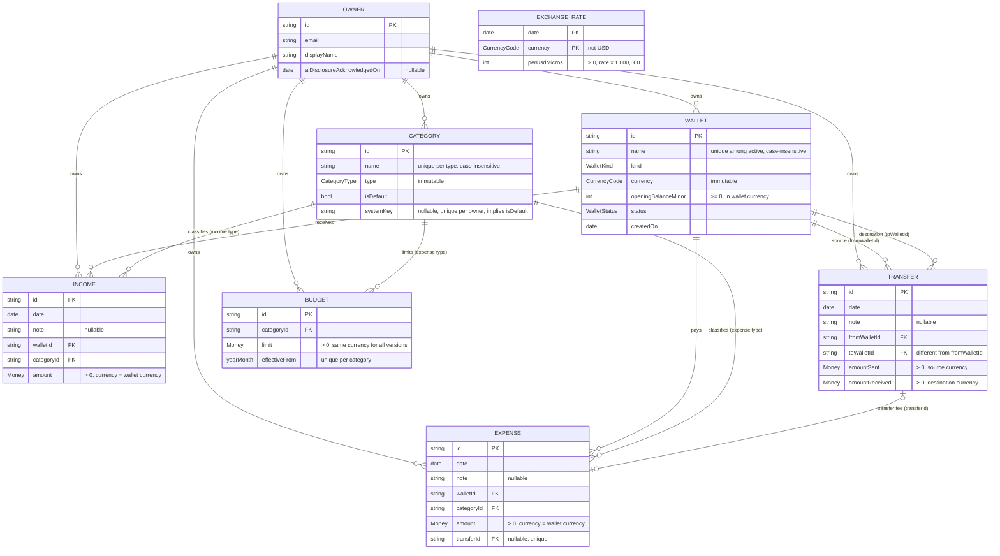
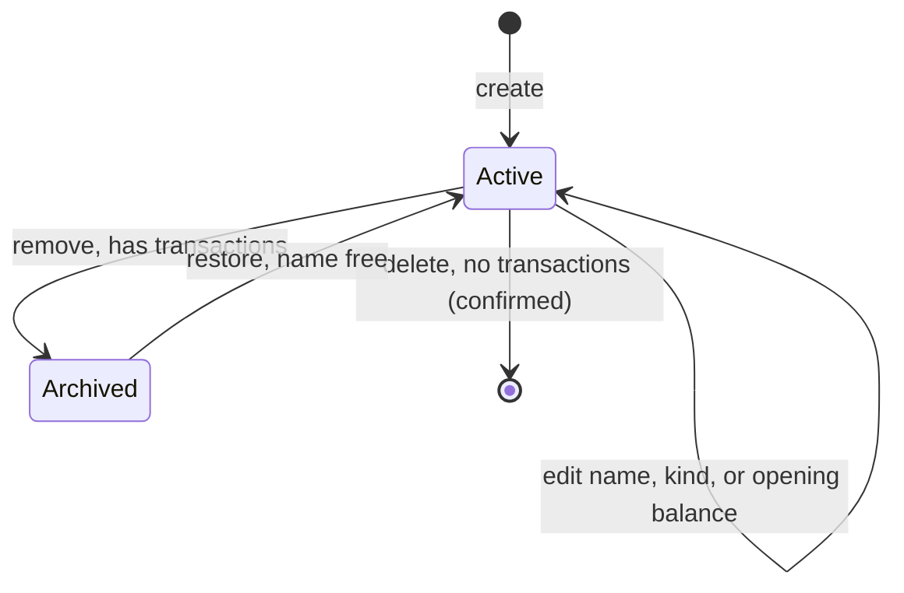
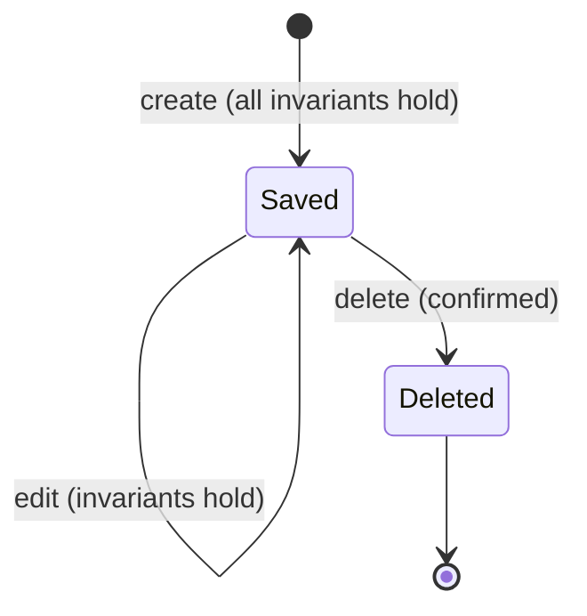
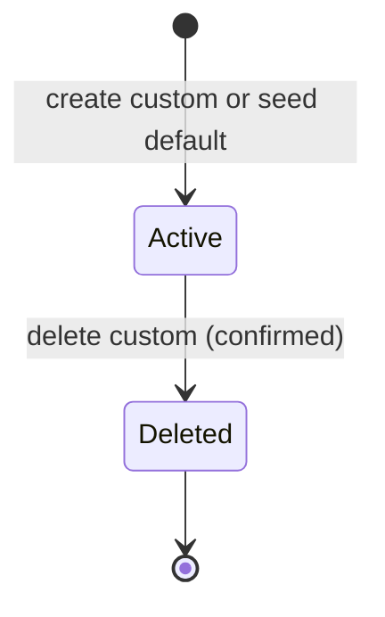
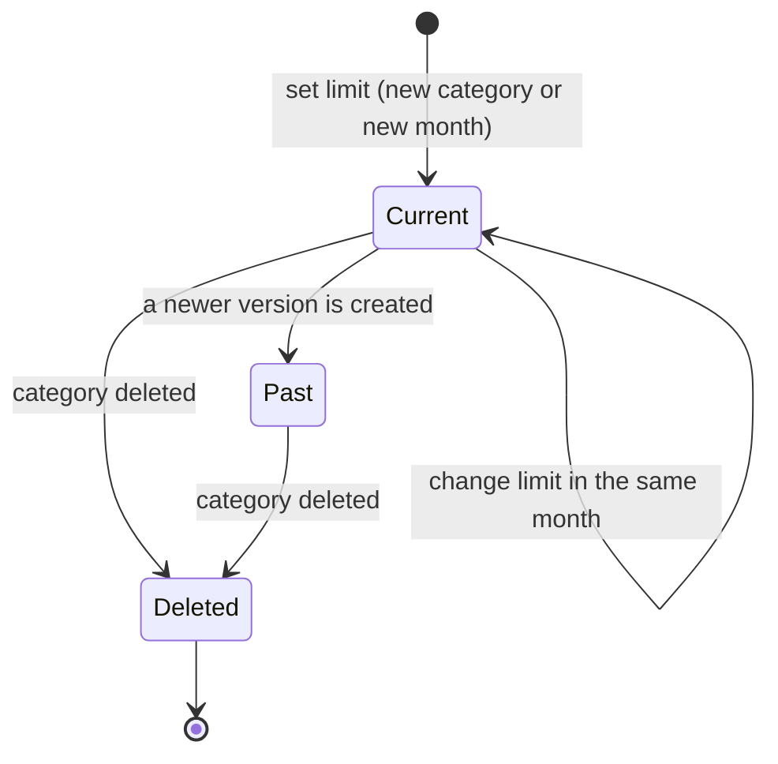
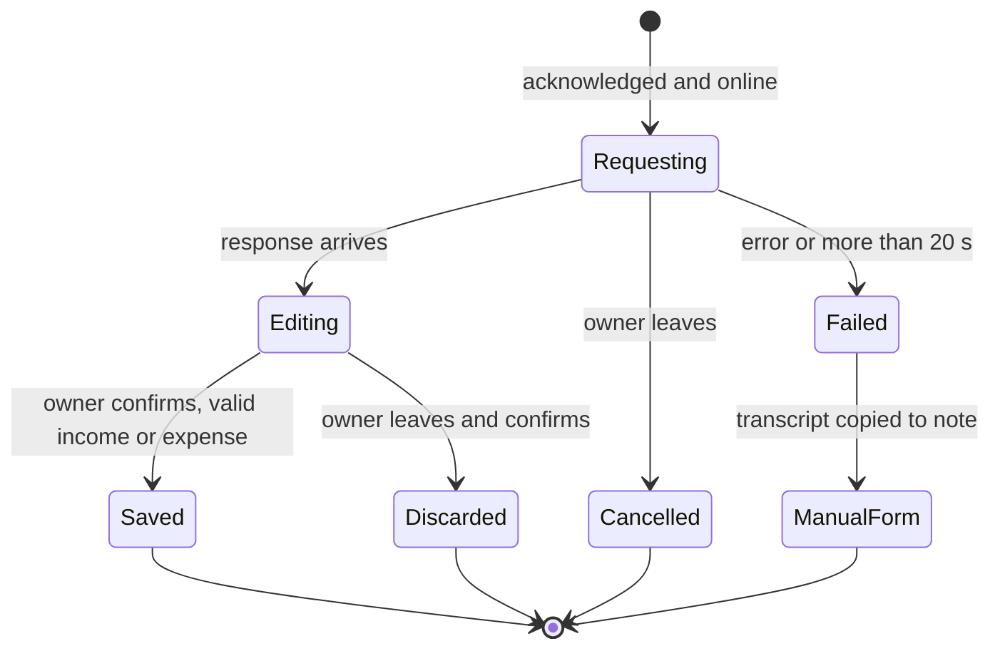
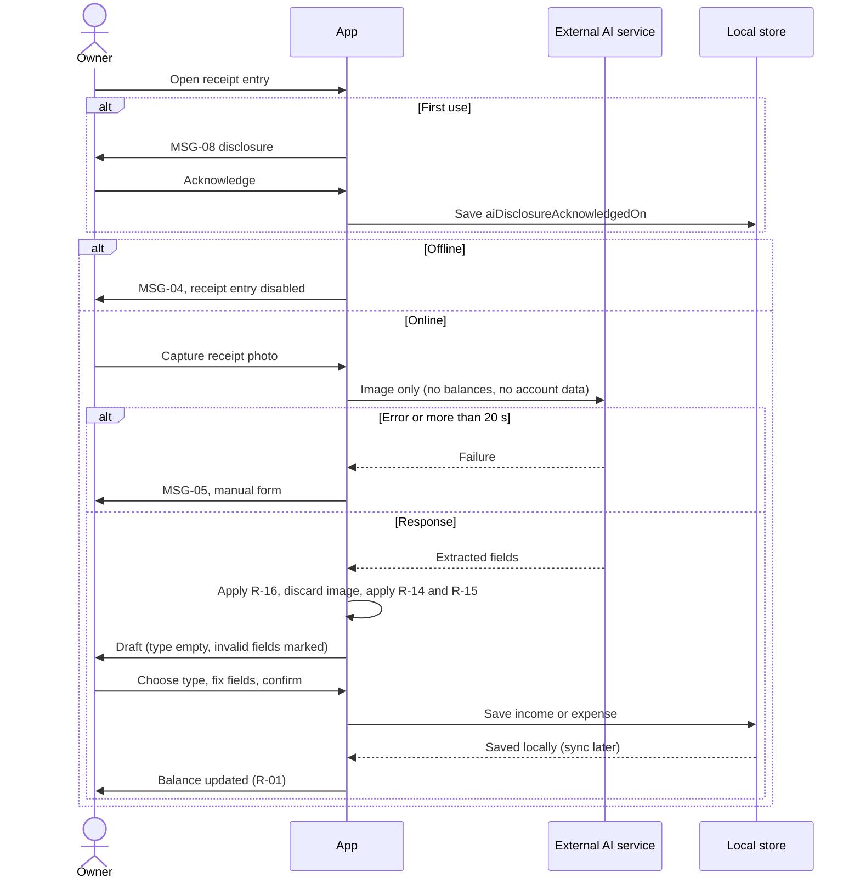

# 03-domain — FinTrack-AI

Status: Accepted v1.3 · 2026-11-15 · Owner: Fadi Abd AlJawwad
Changes in v1.3 (final review): I-13, I-14, I-27 aligned with spec v1.4; R-03 weekend gaps exact; rates as scaled integers (ADR-0007); display currency in owner preferences; deterministic ids for default categories.
Changes in v1.2: JOD rates from the source (ADR-0006).
Changes in v1.1 (from architecture review): reference rates stored as one rate per currency against a USD pivot, synced per owner; "outdated" measured from the last successful refresh.
Sources: `docs/01-brief.md` (v1.1), `docs/02-spec.md` (v1.4), modeling decisions M1–M7 (owner, 2026-11-15).
Review log: `claude/fintrack/03-domain-review-v1.md` (Gemini findings, accepted and rejected).

## Modeling decisions

| ID | Decision |
|---|---|
| M1 | Domain types carry plain domain names (`Transaction`, `Wallet`). Persistence types live in the data layer with suffix `Dto`. |
| M2 | `Transaction` is a closed (sealed) family: `Income`, `Expense`, `Transfer`. Every transaction is exactly one of them. No single type with optional fields. |
| M3 | A transfer fee is an `Expense` linked to one `Transfer` through `transferId`. It keeps its own wallet, category, and date so every report treats it as an ordinary expense; invariant I-06 keeps these equal to the transfer's values. |
| M4 | A transaction date is a calendar date without time or time zone. |
| M5 | A budget is versioned: a change in a new month creates a new version with `effectiveFrom` (year-month); a change in the month of the latest version updates that version. |
| M6 | A transaction amount carries its currency (`Money`) on purpose: totals and conversions need no wallet lookup. Drift is impossible because a wallet's currency never changes (I-23) and I-03/I-05 are checked on every write. |
| M7 | Wallet appearance (icon, color) is a presentation preference keyed by wallet id, not a `Wallet` attribute (DQ-2, owner 2026-11-15). |

Scope rule: every entity belongs to exactly one `Owner`. Ownership is the container, not a field on each entity.

Out of the domain on purpose (covered in `04-architecture.md`): authentication and sign-out data removal (US-01 mechanics), app lock (US-02), connectivity, sync queue, deletion markers for sync, server arrival order (BR-25), "Needs attention", AI payload transport.

---

## 1. Glossary

One term, one meaning. Synonyms in other documents are listed so they map to one term.

| Term (EN) | المصطلح | Definition | Code name |
|---|---|---|---|
| Owner | المالك | The single person who operates the account | `Owner` |
| Wallet | المحفظة | A place where the owner holds money, in exactly one currency that never changes | `Wallet` |
| Wallet kind | نوع المحفظة | Closed set: cash, e-wallet, bank | `WalletKind` (`cash`, `eWallet`, `bank`) |
| Wallet status | حالة المحفظة | active or archived | `WalletStatus` |
| Opening balance | الرصيد الافتتاحي | Wallet amount at creation, in the wallet currency; not a transaction, not income | `Wallet.openingBalanceMinor` (int) |
| Money | المبلغ | Exact amount in minor units plus its currency | `Money(minorUnits: int, currency)` |
| Currency | العملة | Closed set: ILS (2 decimals), USD (2), JOD (3) | `CurrencyCode` |
| Transaction | الحركة | Always the supertype: income, expense, or transfer. "Income or expense" is written out when transfers are excluded | `Transaction` (sealed) |
| Income | الدخل | Money entering one wallet | `Income` |
| Expense | المصروف | Money leaving one wallet | `Expense` |
| Transfer | التحويل | One record moving money between two different wallets of the owner | `Transfer` |
| Transfer fee | عمولة التحويل | An expense linked to one transfer (`transferId` set). Spec synonym: "fee" | `Expense` with `transferId` |
| Fees category | فئة الرسوم | System expense category used by every transfer fee; also selectable for manual expenses (for example a bank charge) | `Category` with `systemKey = fees` |
| Category | الفئة | Label for income or expense; default or custom; type never changes | `Category` |
| System category | فئة نظام | Default category the system depends on: Fees, Other (expense), Other (income) | `Category.systemKey` |
| Budget | الميزانية | Monthly limit for one expense category, versioned | `Budget` |
| Reference rate | سعر الصرف المرجعي | Daily rate of one currency against the USD pivot (units of that currency per 1 USD). "Latest reference rate" = most recent stored rate (spec: "current reference rate"). Shared by all devices of the owner | `ExchangeRate` |
| Rate book | سجل الأسعار | All stored reference rates plus the date of the last successful refresh | `RateBook` |
| Display currency | عملة العرض | Owner preference for net worth and reports; also the currency of a new budget. Stored once, in the owner's synced preferences | `OwnerPreferences.displayCurrency` |
| AI disclosure acknowledgment | إقرار الإفصاح | Date the owner acknowledged MSG-08; recorded once per owner | `Owner.aiDisclosureAcknowledgedOn` |
| Draft | المسودة | Unsaved, possibly incomplete result of voice or receipt input; becomes an income or expense only on save | `TransactionDraft` |
| Net worth | صافي الثروة | Sum of all wallet balances (active and archived) in the display currency; computed | `NetWorth` (value) |
| Conversion quality | جودة التحويل | exact, approximate, outdated, unavailable | `ConversionQuality` |
| Local today | اليوم المحلي | The device's local calendar date at the moment of the action | `Clock.localToday()` |

---

## 2. Entity-relationship model

Notes
- `INCOME`, `EXPENSE`, and `TRANSFER` are the three disjoint kinds of `Transaction` (M2). They share `id`, `date`, and `note`. Mermaid cannot draw an exclusive supertype, so the supertype is stated here, not drawn.
- `EXCHANGE_RATE` stores one rate per (date, currency) against USD; USD is implicitly 1. Rates are synced per owner so all devices convert the same way. JOD rows come from the rate source like ILS (ADR-0006). Stored rows never change, so later rate changes never alter past conversions.
- `TransactionDraft` is not an entity: it lives in memory only and is never persisted (I-20). Its shape is in section 5.

---

## 3. Invariants and where they are enforced

**Domain** = pure Dart domain code with unit tests. **Rules** = server access rules. **Data** = data layer (atomic writes). An invariant enforced only in Domain is not protected against a tampered client; accepted for v1 unless `04` decides otherwise (DQ-1).

| ID | Invariant | Source | Enforced in |
|---|---|---|---|
| I-01 | Every transaction amount (`amount`, `amountSent`, `amountReceived`) is > 0 | BR-06 | Domain + Rules |
| I-02 | Minor units are integers; decimals never exceed the currency precision | BR-01 | Domain (by type) + Rules |
| I-03 | An income or expense amount currency equals its wallet currency | BR-02 | Domain |
| I-04 | `fromWalletId` ≠ `toWalletId` | AC-06.6 | Domain + Rules |
| I-05 | `amountSent` currency = source wallet currency; `amountReceived` currency = destination wallet currency; same currency ⇒ `amountReceived` = `amountSent` | BR-11 | Domain |
| I-06 | A transfer fee has the Fees category, the transfer's source wallet, and the transfer's date, always | AC-06.4, AC-06.10 | Domain |
| I-07 | A transfer has at most one fee (`transferId` unique) | AC-06.4 | Domain + Data (fee identity derived from transfer id) |
| I-08 | A transfer and its fee are created, changed, and deleted together | BR-10 | Data (atomic batch) |
| I-09 | When a transaction date is set or changed, it is not after local today; an unchanged date is not re-checked | BR-08, AC-09.6 | Domain (compares old and new value) |
| I-10 | An income uses an income category; an expense uses an expense category | AC-13.2 | Domain |
| I-11 | Active wallet names are unique per owner (case-insensitive); restoring an archived wallet requires its name to be free | AC-03.5, AC-04.7 | Domain (cross-device race accepted) |
| I-12 | Category names are unique per owner and type (case-insensitive) | AC-13.3 | Domain |
| I-13 | No transaction is created in, or moved into, an archived wallet. Existing transactions in an archived wallet can be corrected or deleted | AC-04.3, AC-04.9 | Domain + Rules (ADR-0008) |
| I-14 | A wallet that has or ever had a transaction is never deleted | BR-05, AC-04.1 | Domain + Rules (`hasTransactions`, ADR-0003) |
| I-15 | Exactly one category per system key (`fees`, `otherExpense`, `otherIncome`) exists per owner; system and default categories cannot be deleted; `systemKey` set ⇒ `isDefault`; default categories have fixed ids so two devices never create duplicates | AC-13.1, AC-13.5 | Domain |
| I-16 | At most one budget version per (category, effectiveFrom); budgets only for expense categories | AC-12.7, AC-12.8 | Domain |
| I-17 | `Budget.limit` > 0 | AC-12.4 | Domain + Rules |
| I-18 | `Wallet.openingBalanceMinor` ≥ 0 | AC-03.6 | Domain + Rules |
| I-19 | Only the owner reads or writes the owner's data | BR-27 | Rules |
| I-20 | A draft is never persisted, starts with an empty type, and can only become an income or an expense | BR-07, BR-19 | Domain |
| I-21 | `ExchangeRate.perUsdMicros` > 0 (integer, rate × 10^6, ADR-0007), currency ≠ USD, one rate per (date, currency); a stored row never changes | NFR-07, AC-11.2 | Domain + Data + Rules |
| I-22 | Every income or expense references an existing category of the right type; when a custom category is deleted its references move to the matching "Other" system category | AC-13.4, AC-13.6 | Domain |
| I-23 | `Wallet.currency` and `Category.type` never change after creation | BR-02, I-10 | Domain + Rules |
| I-24 | Currency ∈ {ILS, USD, JOD}; wallet kind ∈ {cash, eWallet, bank} | BR-03, AC-03.1 | Domain (enums) + Rules |
| I-25 | All versions of one category's budget share one currency: the owner's display currency when the first version was created | AC-12.6 | Domain |
| I-26 | Deleting a custom category deletes all its budget versions | AC-13.4 | Domain + Data (same batch) |
| I-27 | An archived wallet's name, kind, and opening balance cannot be edited; an active wallet's can (AC-03.8) | AC-03.8, AC-04.3 | Domain |

---

## 4. Domain rules (computations)

Pure functions in the domain. Each has unit tests named after the ACs it serves.

| ID | Rule | Serves |
|---|---|---|
| R-01 | **Wallet balance** = `openingBalanceMinor` + Σ income − Σ expense (fees included) − Σ `amountSent` where source + Σ `amountReceived` where destination; all time; wallet currency | AC-10.1, AC-10.6 |
| R-02 | **Net worth** = Σ over all wallets, active and archived, of balance converted at the latest reference rate to the display currency | AC-10.2, AC-04.4 |
| R-02b | **Conversion** A → B on date d = amount × perUsd(B, d) ÷ perUsd(A, d), with perUsd(USD) = 1; exact integer fraction (ADR-0007), rounded once at display; same formula both ways, so conversions are symmetric | NFR-05, NFR-07 |
| R-03 | **Rate for a date** = rate stored for that date; else the nearest earlier rate: 1–4 days earlier = `exact` (weekend and holiday gaps of the source), 5–7 days = `approximate`; else none (`unavailable`) | AC-11.2, AC-11.5, AC-11.6 |
| R-04 | **Latest rate quality** = `outdated` when the last successful refresh (`RateBook.lastRefreshedOn`) is more than 3 days before local today; `unavailable` when no rate exists; else `exact`. Source gaps on weekends or holidays do not count | AC-10.4, AC-10.5, BR-17 |
| R-05 | **Converted total** = Σ convertible amounts, computed exactly, rounded half-up for display only; carries the worst quality of its parts and the count of excluded amounts | BR-15, AC-11.6 |
| R-06 | **Period totals**: income and expense summed separately, each converted at its own date rate (R-03); transfers excluded; a period includes dates from start to end inclusive | AC-11.1, AC-11.2, BR-09 |
| R-07 | **Comparison period** = the period of equal length that ends the day before the selected start | AC-11.3 |
| R-08 | **Valid range**: start ≤ end ≤ local today | AC-11.7 |
| R-09 | **Budget for month M** = the version with the greatest `effectiveFrom` ≤ M; none if no such version | AC-12.5, AC-12.3 |
| R-10 | **Budget progress** = Σ expenses of the category in month M, each converted to the budget currency at its date rate (R-03); remaining = limit − spent; over budget when spent > limit | AC-12.1, AC-12.2, AC-12.6 |
| R-11 | **Overdraft check** = save needs confirmation when amount (or `amountSent` + fee) > current source balance (R-01) | AC-05.6, AC-06.8, BR-12 |
| R-12 | **Suggested received amount** = `amountSent` converted with R-02b at the latest rates, rounded half-up to destination precision; none when no rate (field stays empty) | AC-06.3, AC-06.7 |
| R-13 | **Fee change**: fee set to 0 deletes the fee; fee from 0 to > 0 creates it; any change of transfer source wallet or date is applied to its fee in the same batch | AC-06.10, AC-06.11, I-08 |
| R-14 | **Draft matching**: a wallet or category name from the AI matches only an active wallet / existing category whose name equals it case-insensitively; otherwise the field stays empty | AC-07.2 |
| R-15 | **Draft validation on open**: type empty; amount empty if missing or invalid; date marked invalid if after local today; wallet marked invalid if its currency differs from the extracted currency | AC-07.4, AC-08.3, AC-08.4, AC-08.5 |
| R-16 | **Allowed AI fields**: keep amount, currency, date, merchant (as note), category; remove any other field; remove every 13–19 digit sequence (spaces or dashes allowed) from text | AC-08.2, BR-20 |
| R-17 | **Wallet change on edit**: moving an income or expense to a wallet with another currency clears the amount; saving requires a new amount | AC-09.5 |

---

## 5. Draft shape (value, not entity)

| Field | Type | Note |
|---|---|---|
| source | voice \| receipt | |
| type | income \| expense \| empty | always empty when created (I-20) |
| amount | Money? | |
| extractedCurrency | CurrencyCode? | used for R-15 mismatch check |
| date | date? | |
| note | string? | merchant or transcript |
| walletId | id? | R-14 |
| categoryId | id? | R-14 |

A draft is partial by nature, so every field is optional. Saving turns it into a valid `Income` or `Expense`; all invariants apply at that moment.

---

## 6. Lifecycles

### Wallet

Forbidden (each is a test)
- Change of currency in any state (I-23).
- Archived → deleted (I-14).
- Archived → edited, or used by a new or moved transaction (I-13, I-27).
- Archived → Active while an active wallet has the same name (I-11).
- Creation in Archived state (only `create` → Active exists).

### Transaction (income, expense, transfer)

Forbidden
- Change of kind (income ↔ expense ↔ transfer) on edit: delete and re-create instead.
- Direct edit or delete of a transfer fee: only through its transfer (R-13, AC-06.11).
- Setting a new date after local today (I-09).
- Moving to a wallet of another currency without a new amount (R-17).
- Deleted → Saved: a later edit from another device does not restore it (BR-25, AC-09.8).

### Category

Forbidden
- Delete of a default or system category (I-15).
- Change of type (I-23).
- Deleted → referenced: every reference moves to the matching "Other" (I-22), including references synced later (AC-13.6).

### Budget version

Forbidden
- Edit of a Past version (AC-12.5).
- A version with a different currency from the category's earlier versions (I-25).
- A version for an income category (I-16).

### Transaction draft

Forbidden
- [*] → Requesting without acknowledgment (`aiDisclosureAcknowledgedOn` empty) or while offline (BR-22, BR-23).
- Requesting → Saved, or Editing → Saved without owner confirmation (BR-19).
- Editing → Saved as a transfer (I-20).
- Editing → Saved while type is empty, date is after local today, or wallet currency mismatches (R-15).
- A response that arrives after Cancelled or Failed changes nothing (it is ignored).
- Any state → persisted draft (I-20).

---

## 7. Sequence — US-08 receipt entry

---

## 8. Consistency matrix (stories × entities)

C = create, R = read, U = update, D = delete. "System" = not a story: the daily rate refresh (BR-18).

| Story | Owner | Wallet | Category | Income / Expense | Transfer | Budget | ExchangeRate |
|---|---|---|---|---|---|---|---|
| US-01 Account access | C R | R | R | R | R | | |
| US-02 App lock | | | | | | | |
| US-03 Create wallet | | C R | | R | | | |
| US-04 Archive / restore / delete | R | R U D | | R | R | | R |
| US-05 Income / expense | | R | R | C R | R | | |
| US-06 Transfer | | R | R | C R U D (fee) | C R U D | | R |
| US-07 Voice entry | R U | R | R | C | | | |
| US-08 Receipt entry | R U | R | R | C | | | |
| US-09 Edit / delete | | R | R | R U D | R U D | | |
| US-10 Balances, net worth | R U | R | | R | R | | R |
| US-11 Insights | R | | R | R | R | | R |
| US-12 Budgets | R | | R | R | | C R U | R |
| US-13 Categories | | | C R D | U (move to Other) | | D | |
| US-14 Offline, sync | R | C R U D | C R D | C R U D | C R U D | C R U D | C R |
| System: rate refresh | | | | | | | C |

Findings
- US-02 touches no domain entity: app lock is a device setting (`04`).
- `ExchangeRate` is created only by the system refresh (`04`).
- `Category` has no update: renaming categories is not in v1 (spec Not now).
- No entity is untouched. No term has two meanings (glossary maps spec synonyms).

---

## 9. Audit against common model mistakes (S02 card 14)

| Mistake | Result |
|---|---|
| One generic entity for all roles | Avoided: three disjoint transaction kinds (M2) |
| Redundant relation creating two sources of truth | Documented and guarded: `Money` currency (M6 + I-23), fee wallet/category/date (M3 + I-06 + I-08). No `ownerId` on entities. Opening balance stores minor units only |
| Wrong multiplicity | Checked: transfer–fee 0..1 to 0..1 (I-07); budget versions per category (M5); exclusive transaction kinds stated in text |
| Missing invariant (unique constraint, state) | Covered: I-11, I-12, I-15, I-16, I-21 uniqueness; lifecycles for wallet, transaction, category, budget, draft |
| No history or change log | Accepted: edit history out of scope (brief). Budget history by versioning (M5). Sync ordering and deletion markers are infrastructure (`04`) |
| UI properties inside domain entities | Avoided: wallet icon/color out of `Wallet` (M7). `displayCurrency` is a domain preference (it decides a new budget's currency, I-25), kept in `OwnerPreferences` |

## 10. Handed to `04-architecture.md`

| ID | Topic |
|---|---|
| DQ-1 | Server-side enforcement of I-03, I-13, I-14 (needs extra reads in access rules) |
| A-1 | Sync: server arrival order (BR-25), deletion markers so a deleted record is not re-created (AC-04.8, AC-09.8, AC-13.6), Needs attention |
| A-2 | Authentication flows and removal of local data on sign-out (US-01) |
| A-3 | App lock as a device setting (US-02) |
| A-4 | Daily rate refresh: source, schedule, storage (BR-18) |
| A-5 | Storage of wallet appearance preferences (M7): device-local or synced owner preference |
