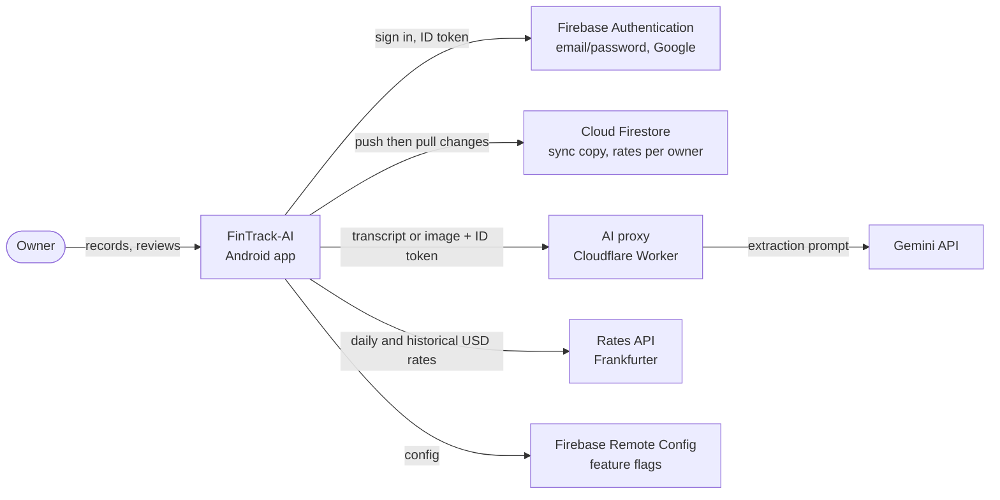
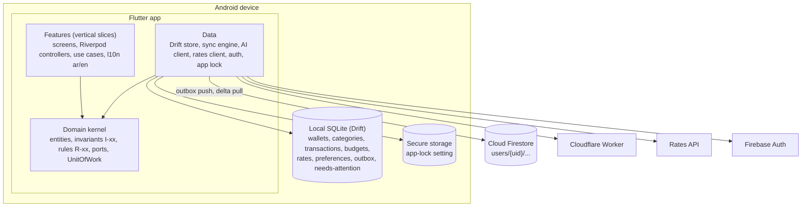
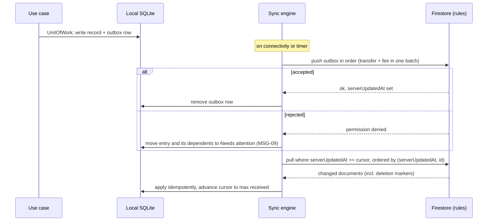

# 04-architecture — FinTrack-AI

Status: Accepted v1.3 · 2026-11-15 · Owner: Fadi Abd AlJawwad
Changes from draft v1: aligned with ADR-0001..0005 v2 (then 0006–0008) after the devil's-advocate review (`claude/fintrack/04-architecture-review-v1.md`).
Changes in v1.3 (S03/S04 alignment, `claude/fintrack/08-s03-s04-alignment-review.md`): localization row (BR-30..BR-32), legacy notes source removed.
Sources: `docs/02-spec.md` (v1.5), `docs/03-domain.md` (v1.3), legacy production notes (risks S1–S8, carried into §7; file deleted 2026-11-15 as a stale distractor), ADR-0001..0008.

## 1. Quality attributes (top 3, owner 2026-11-15)

| Rank | Attribute                 | Measurable requirement                                                                              | Effect on architecture                                                                                                           |
|------|---------------------------|-----------------------------------------------------------------------------------------------------|----------------------------------------------------------------------------------------------------------------------------------|
| 1    | Offline-first reliability | NFR-04: 500 transactions over 30 days offline, 0 lost or duplicated; BR-23                          | Source of truth on the device; outbox and staged sync engine (ADR-0002)                                                          |
| 2    | Correctness of money      | NFR-05 exact balances; NFR-07 no floating point; R-01 all-time balances; R-02b symmetric conversion | Integer minor units; integer rates against a USD pivot (ADR-0005, ADR-0007); aggregates in SQL tested on real queries (ADR-0001) |
| 3    | Cost                      | Firebase Spark only: 50,000 reads / 20,000 writes per day; no card                                  | No Cloud Functions; delta sync; 1–2 reads per transaction write in access rules (ADR-0003); free-tier proxy (ADR-0004)           |

Secondary: privacy and security (NFR-08, NFR-09), AI latency on a weak network (NFR-02a ≤ 8 s voice, NFR-02b ≤ 12 s receipt, 3G profile; real network weak and unmeasured), localization (NFR-10), explainability.

Accepted trade-offs: a custom sync engine (risk) for offline + cost; a few billed reads per write for server-side integrity; a second platform (Cloudflare) for AI latency and abuse limits.

---

## 2. Context (C4 level 1)



The Worker verifies Firebase ID tokens locally against Google's public keys; it does not call Firebase per request.

---

## 3. Containers (C4 level 2)



Dependency rule (ADR-0001): `features → domain ← data`. Features never import other features. Domain imports no Flutter, Firebase, HTTP, or Drift. Enforced by architecture tests.

Layout:
```
lib/
  domain/      entities, value objects (Money, CurrencyCode), invariants, rules R-xx, ports
  data/        drift/ (schema, DAOs, SQL aggregates), sync/ (outbox, push, pull), remote/ (Firestore maps),
               ai/ (Worker client), rates/ (Frankfurter client), auth/, app_lock/
  features/    <feature>/ presentation + use cases (accounts, wallets, transactions, transfers,
               assisted_entry, insights, budgets, categories, settings, needs_attention)
  core/        theme, l10n, routing, DI wiring (no business rules)
```

---

## 4. Ports and adapters

| Port (domain)                                                     | Adapter (data)                         | Purpose                                                                      | Spec                 |
|-------------------------------------------------------------------|----------------------------------------|------------------------------------------------------------------------------|----------------------|
| `WalletStore`, `CategoryStore`, `TransactionStore`, `BudgetStore` | Drift DAOs                             | Local reads/writes; aggregates (balances, period and category totals) as SQL | R-01, R-06, R-10     |
| `RateStore`                                                       | Drift DAO + synced rate documents      | Rate book: rows per (date, currency) vs USD, `lastRefreshedOn`               | R-02b..R-05          |
| `PreferenceStore`                                                 | Drift DAO + synced preference document | Display currency, wallet appearance (AC-03.7)                                | US-10, AC-03.7       |
| `UnitOfWork`                                                      | Drift transaction                      | One atomic local transaction across stores + outbox rows                     | I-08, I-26, ADR-0002 |
| `SyncGateway`                                                     | Sync engine (Firestore)                | Push then pull; FIFO outbox; held dependents; cursor; Needs attention        | US-14, BR-24, BR-25  |
| `AiExtractor`                                                     | Worker HTTP client                     | Transcript or ≤ 60 KB grayscale image → allowed fields; 20 s timeout         | US-07, US-08         |
| `RateProvider`                                                    | Frankfurter v2 client                  | Daily and range fetch, base USD, symbols ILS and JOD (ADR-0006)              | BR-18                |
| `AuthGateway`                                                     | Firebase Auth + Google Sign-In         | Sign up, sign in, reset, sign out                                            | US-01                |
| `AppLock`                                                         | local_auth + secure storage            | Biometric with device-credential fallback; 30 s relock                       | US-02                |
| `Clock`                                                           | System clock                           | Local today                                                                  | I-09, R-08           |

Calculation split (ADR-0001): per-item rules in pure Dart; aggregates in SQL, tested as AC tests on an in-memory Drift database.

---

## 5. Sync (summary of ADR-0002)



Rules, ordering, cursor, and staged delivery: see ADR-0002 (single source). The diagram is an overview only.

---

## 6. Data in Firestore (sync copy)

```
users/{uid}                          owner profile
users/{uid}/preferences/main         display currency, wallet appearance
users/{uid}/wallets/{walletId}       + hasTransactions (false → true only)
users/{uid}/categories/{categoryId}
users/{uid}/transactions/{txId}      kind: income | expense | transfer
users/{uid}/budgets/{budgetId}
users/{uid}/rates/{year}             map: date → {currency: perUsd}; write-once entries
```
Every synced document carries `serverUpdatedAt` (server timestamp) and `deleted` (bool). Fee document id is derived from its transfer id (I-07).

Access rules: see ADR-0003 (single source; not repeated here).

---

## 7. Security model

| ID  | Topic                     | v1 decision                                                                                                                                                          | Production note                                            |
|-----|---------------------------|----------------------------------------------------------------------------------------------------------------------------------------------------------------------|------------------------------------------------------------|
| S1  | Access rules              | ADR-0003 (ownership, schema, cross-document checks, deletion protection); emulator tests in CI                                                                       | —                                                          |
| S2  | App lock                  | Opt-in; launch + 30 s relock; device-credential fallback                                                                                                             | —                                                          |
| S3  | App Check                 | Not enabled                                                                                                                                                          | Enable Play Integrity; enforce on Firestore and the Worker |
| S4  | Local data after sign-out | Database file and secure-storage entries deleted (AC-01.5); data restored from Firestore on sign-in                                                                  | —                                                          |
| S5  | Android backup            | `allowBackup=false`                                                                                                                                                  | —                                                          |
| S6  | Logs                      | Debug-only; no uid, tokens, amounts, or secrets                                                                                                                      | —                                                          |
| S7  | AI proxy                  | Worker: ID-token verification (signature, audience, issuer, expiry), per-user limit, global daily cap; Gemini key only in Worker secret; no shared secret in the app | Add App Check token verification                           |
| S8  | Firebase API keys         | Client identifiers, restricted by rules                                                                                                                              | Restrict by package name and SHA-1                         |
| S9  | Local database encryption | Not in v1 (OS sandbox)                                                                                                                                               | SQLCipher for rooted-device threat models                  |
| S10 | AI privacy                | Payload = transcript or ≤ 60 KB image only; response filtered (R-16); image discarded (BR-21); MSG-08 acknowledgment                                                 | Verify training-use terms (O-3) before release             |

---

## 8. Cross-cutting

| Concern       | Decision                                                                                                                                                                                                                                                                                    |
|---------------|---------------------------------------------------------------------------------------------------------------------------------------------------------------------------------------------------------------------------------------------------------------------------------------------|
| Localization  | ARB files (ar, en) with key and placeholder parity checked in the gate; RTL with directional widgets; messages by MSG-ID; ICU plurals with all six Arabic categories; one formatting module in `lib/core` for numbers and dates (BR-30..BR-32) and one input normalizer (BR-31) (NFR-10)    |
| Errors        | Adapters translate SDK/HTTP errors into typed domain failures; features map failures to MSG-IDs                                                                                                                                                                                             |
| Money         | `Money(minorUnits: int, currency)`; integer rates (ADR-0007); half-up display rounding at the edge (BR-15)                                                                                                                                                                                  |
| Testing       | One test per AC, named by ID; tests are the contract; architecture tests (ADR-0001); access-rule tests on the emulator (ADR-0003); sync tests with emulator and fake clock (ADR-0002); Worker tests (ADR-0004); NFR-02a/02b runs on the 3G profile and then on the owner's measured network |
| Configuration | Build-time defines for endpoints; feature flags in Remote Config; Gemini key only in the Worker                                                                                                                                                                                             |

---

## 9. Decisions index

| ADR  | Title                                                                  | Status                                       |
|------|------------------------------------------------------------------------|----------------------------------------------|
| 0001 | Shared domain kernel with vertical feature slices                      | Accepted (v2)                                |
| 0002 | Local database source of truth with staged delta sync                  | Accepted (v2)                                |
| 0003 | Access rules validate ownership, schema, and cross-document invariants | Accepted (v2)                                |
| 0004 | Gemini behind a Cloudflare Worker proxy, behind one port               | Accepted (v2)                                |
| 0005 | Rates fetched by the device, synced per owner, USD pivot               | Accepted (v2), JOD bullet superseded by 0006 |
| 0006 | JOD rates come from the rate source                                    | Accepted                                     |
| 0007 | Rates as scaled integers, exact conversion without a decimal package   | Accepted                                     |
| 0008 | Archived-wallet check only on create and move (amends 0003)            | Accepted                                     |

Pending (next free number): state management version (Riverpod 2.6 vs 3), after stage 0 (gap analysis D-01).
